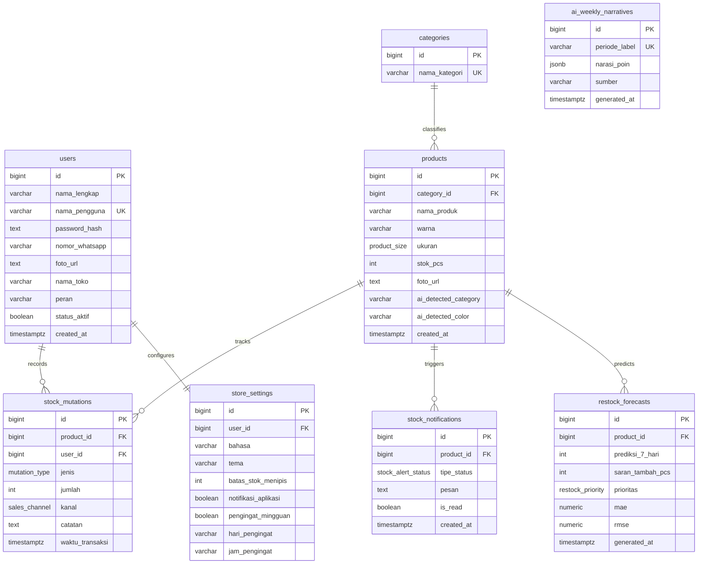

# CAPSTONE PROJECT — A26-CS149 (RoyalStore)

**Sistem Manajemen dan Pencatatan Stok Pakaian Berbasis Digital — Royal Thrift Store**  
Program **Asah 2026** *led by Dicoding supported by GoTo*

---

## Anggota Tim (`roadtogoto`)

| ID | Nama | Learning Path |
| :--- | :--- | :--- |
| `FS308B6Y0130` | Ale Aprilian Putra Anton | AI Full-Stack Developer |
| `FS308B6X0874` | Kenhairani Baeha | AI Full-Stack Developer |
| `FS308B6X1703` | T. Syarifah Gita Azzahra | AI Full-Stack Developer |
| `AE308B6X1332` | Nasywa Razhan Deethia | Next-Gen AI Engineer |
| `AE704B6Y1785` | Yanuarizal Kurnia | Next-Gen AI Engineer |
| `DS200B6Y1593` | Rizky Andrian | Data Science Specialist |

---

## Struktur Proyek, Frontend, & Backend

```text
CAPSTONE_PROJECT-A26-CS149/
├── database/
│   └── supabase_schema.sql  # Skema PostgreSQL Supabase lengkap (8 tabel, view, trigger, RPC)
├── backend/                 # REST API Node.js + Express terhubung ke Supabase
│   ├── src/
│   │   ├── config/          # Konfigurasi env & client Supabase
│   │   ├── controllers/     # Health, Categories, Products (CRUD)
│   │   ├── middlewares/     # Async & global error handler
│   │   ├── repositories/    # Supabase repository & in-memory dev store
│   │   ├── routes/          # Routing /api/categories & /api/products
│   │   └── utils/           # Validasi payload, aturan privasi, filter/sort
│   ├── tests/               # Pengujian integrasi HTTP endpoint
│   ├── .env.example
│   ├── package.json
│   └── README.md            # Dokumentasi detail & kontrak API backend
├── frontend/                # Antarmuka web pemilik toko (React 19 + Vite + Tailwind CSS 4)
│   ├── public/
│   ├── src/
│   │   ├── components/      # Sidebar, Topbar, ProductToolbar, ProductTable, StatusBadge, Pagination, dll.
│   │   ├── layouts/         # DashboardLayout
│   │   ├── pages/           # ProdukPage (Daftar Produk), PlaceholderPage
│   │   ├── data/            # mockProducts.js (24 data contoh selaras skema DB)
│   │   ├── services/        # api.js (Axios) & productService.js
│   │   └── utils/           # stock.js (aturan status stok 0 / 1–3 / >3 pcs)
│   ├── .env.example
│   ├── package.json
│   ├── vite.config.js
│   └── README.md            # Dokumentasi detail khusus frontend
├── .gitignore
└── README.md
```

### Progres Minggu 1
* **Database (`database/supabase_schema.sql`):** Skema PostgreSQL Supabase final (8 tabel, constraint lengkap, view dinamis `v_products_with_status`, trigger notifikasi otomatis, serta RPC transaksi stok atomik).
* **Backend (`backend/`):** REST API Node.js + Express terintegrasi `@supabase/supabase-js` dengan endpoint `/api/health`, `/api/categories`, dan CRUD `/api/products` (lengkap dengan validasi stok integer `>= 0` dan penjagaan privasi tanpa harga/margin). Detail di [`backend/README.md`](./backend/README.md).
  ```bash
  cd backend
  npm install
  npm run dev
  ```
* **Frontend (`frontend/`):** React 19, Vite, Tailwind CSS 4 (`@tailwindcss/vite`), React Router, `lucide-react`, `@fontsource-variable/inter`, Axios — layout dashboard responsif & halaman **Daftar Produk** dengan `24` data contoh. Detail di [`frontend/README.md`](./frontend/README.md).
  ```bash
  cd frontend
  npm install
  npm run dev
  ```
  Lalu buka `http://localhost:5173`.

---

## Gambaran Database (Supabase / PostgreSQL)

Sistem menggunakan **Supabase (PostgreSQL)** sebagai basis data utama yang diakses bersama oleh layanan Backend (Node.js/Express), AI Service (FastAPI), dan pipeline Data Science. Sesuai ketentuan privasi UMKM **Royal Thrift Store**, skema database **tidak menyimpan data harga modal, harga jual, maupun margin keuntungan**.

### Entity Relationship Diagram (ERD)



### Struktur Tabel Inti

| Tabel | Peran & Kegunaan | Relasi & Constraint Penting |
| :--- | :--- | :--- |
| **`users`** | Data autentikasi & profil pemilik toko (`01 masuk`, `11 profil`). | `pk_users`, `uq_users_nama_pengguna`, validasi format username & nomor WhatsApp. |
| **`store_settings`** | Preferensi bahasa, tema, serta ambang batas stok menipis (`09 pengaturan`). | `fk_store_settings_user` (`1:1` ke `users`), default `batas_stok_menipis = 3`, rentang `0–1000`. |
| **`categories`** | Master kategori pakaian (`Blouse`, `Cardigan`, `Kemeja`, `Dress`, `Jaket`, `Rok`, `Celana`). | `pk_categories`, `uq_categories_nama`. |
| **`products`** | Katalog stok aktif & hasil auto-fill Computer Vision (`03`, `04`, `05`, & sumber live RAG). | `fk_products_category` (`ON DELETE RESTRICT`), `uq_products_variant` `(nama_produk, warna, ukuran)`, `stok_pcs >= 0`. |
| **`stock_mutations`** | Riwayat barang keluar/penjualan & stok masuk (`06 transaksi`, grafik `02`/`07`, dataset DS). | `fk_mutations_product`, `jumlah > 0`, `chk_mutations_kanal_jenis` memisahkan kanal `KELUAR` dan `MASUK`. |
| **`stock_notifications`** | Daftar peringatan stok habis/menipis untuk badge lonceng & `10 notifikasi`. | `uq_notifications_product` (`1:1` per produk kritis), tersinkron otomatis lewat trigger. |
| **`restock_forecasts`** | Menyimpan hasil prediksi permintaan 7 hari, saran tambah unit, `MAE`, & `RMSE` (`07`, `08`). | `uq_forecasts_product`, seluruh nilai prediksi & error metrik `>= 0`. |
| **`ai_weekly_narratives`** | Menyimpan narasi bisnis mingguan dari LLM serta cadangan *fallback* jika kuota API habis. | `uq_ai_narratives_periode`, `sumber IN ('LLM_PROPRIETARY', 'FALLBACK_RULE')`, validasi JSON array. |

### Aturan Bisnis & Otomasi Database

* **Status Stok Dinamis (`v_products_with_status`):** Status produk dihitung otomatis dari `store_settings.batas_stok_menipis` (default **`3 pcs`**):
  * `0 pcs` $\rightarrow$ **`Habis`**
  * `1 – 3 pcs` $\rightarrow$ **`Menipis`**
  * `> 3 pcs` $\rightarrow$ **`Tersedia`**
* **Sinkronisasi Notifikasi Otomatis:** Trigger `trg_products_sync_notif` & `trg_settings_resync_notif` otomatis membuat notifikasi saat `stok_pcs <= batas_stok_menipis` dan menghapusnya saat stok diisi ulang melebihi batas.
* **Transaksi Stok Atomik (`record_stock_sale` & `record_stock_in`):** Menggunakan *row-level lock* (`FOR UPDATE`) pada tabel `products` untuk mencegah stok minus dan otomatis menolak transaksi penjualan jika stok bernilai `0 pcs`.

---

## Alur Branching (`Git Workflow`)

- **`main`** — Branch stabil siap demo / rilis (dilindungi, hanya menerima *merge* dari `dev`).
- **`dev`** — Branch integrasi utama tempat seluruh fitur FE, BE, AI, dan DS digabungkan & diuji bersama.
- **`feat/<nama-fitur>`** / **`fix/<nama-perbaikan>`** — Branch kerja per tugas yang dibuat dari `dev`, lalu digabung kembali ke `dev` melalui *Pull Request*.

### Contoh Alur Kerja Harian
```bash
git checkout dev
git pull origin dev
git checkout -b feat/nama-fitur
# ... kerjakan & commit ...
git push -u origin feat/nama-fitur
# Buat Pull Request ke branch dev di GitHub
```
